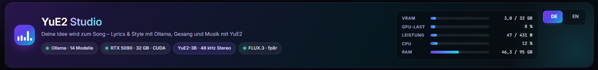
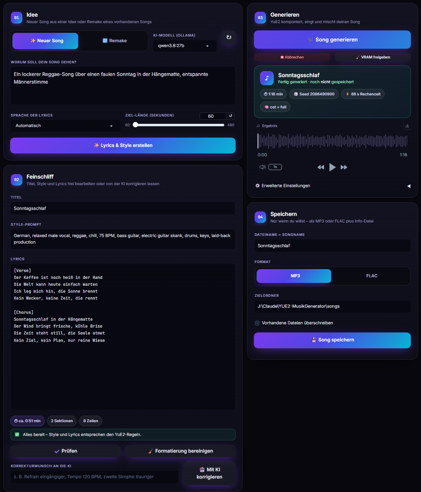

<h1 align="center"></h1>

Lokale Gradio-App für das KI-Musikmodell **YuE2** (`m-a-p/YuE2-3B`).
Lyrics und Style-Prompt erzeugt ein lokales Ollama-Modell über einen Masterprompt. Beides lässt sich danach von Hand oder per KI korrigieren.

> **English:** A local Gradio app (German/English UI) for the AI music model YuE2. A local Ollama model writes the lyrics and style prompt from your idea via a master prompt, and you can refine them by hand or ask the AI to correct them. *New song* turns an idea into a full song. *Remake* transcribes the melody of an uploaded song (SheetSage2) and its vocals (Whisper), then sings new or translated lyrics on the original melody in a new style. Songs are only saved on request, as MP3 or FLAC, together with an info TXT file. Windows · NVIDIA GPU or AMD Radeon GPU (ROCm, untested on real hardware) with ≥ 24 GB VRAM, 16 GB cards in an experimental low-VRAM mode · see *Installation* below (`install.ps1` detects your GPU, then `start.bat`).

Quellen: [YuE2 Prompt-Guide (ComfyUI)](https://docs.comfy.org/tutorials/audio/yue2/yue2) · [YuE GitHub](https://github.com/multimodal-art-projection/YuE)

## Vorschau / Preview

<p align="center"></p>

## Beispiel / Example

Ein mit der App erzeugter Song (Modus *Neuer Song*, Ollama `qwen3.8:27b`, YuE2 `cot=full`, 56 s, Rechenzeit 40 s auf einer RTX 5090):

| Datei | Inhalt |
|---|---|
| [Sonntagsruhe.mp3](examples/Sonntagsruhe.mp3) | MP3, 48 kHz Stereo, 320 kbit/s |
| [Sonntagsruhe.flac](examples/Sonntagsruhe.flac) | FLAC, 48 kHz Stereo, 24 Bit |
| [Sonntagsruhe.txt](examples/Sonntagsruhe.txt) | Info-Datei: Idee, Style, Lyrics, Songlänge, Seed, Einstellungen und geplante Partitur (ABC) |

> **Idee:** „Ein lockerer Reggae-Song über einen faulen Sonntag in der Hängematte, entspannte Männerstimme“
> **Style:** `German, relaxed male vocal, reggae, chill, lazy, 75 BPM, clean electric guitar skank, upright bass, muted drums, warm organ, laid-back groove`

## Voraussetzungen
- **NVIDIA:** Windows 10/11, GPU mit BF16 und ≥ 24 GB VRAM (getestet: RTX 5090)
- **AMD Radeon:** Windows 11, Radeon RX 7000/9000, Radeon AI PRO R9700 oder PRO W7800/W7900, Treiber Adrenalin 26.2.2 oder neuer. Details im Abschnitt [AMD Radeon](#amd-radeon).
- 16-GB-Karten beider Hersteller laufen in einem **experimentellen Sparmodus**.
- [uv](https://docs.astral.sh/uv/), [ffmpeg](https://www.gyan.dev/ffmpeg/builds/) im PATH, git
- [Ollama](https://ollama.com) mit mindestens einem Modell, z. B. `ollama pull qwen3.8:27b`
- ca. 25 GB freier Speicher für Umgebungen und Modelle

## Installation
```powershell
powershell -ExecutionPolicy Bypass -File install.ps1
```
`install.ps1` erkennt die Grafikkarte (die Karte mit dem meisten VRAM entscheidet) und startet den passenden Installer. Du kannst ihn auch direkt aufrufen:

| Installer | Grafikkarte | PyTorch |
|---|---|---|
| `install_nvidia.ps1` | NVIDIA (RTX 30/40/50 …) | Torch 2.10, CUDA 12.8 |
| `install_amd.ps1` | AMD Radeon | Torch 2.9.1, ROCm 7.2.1 (AMD-Wheels für Windows) |

Beide legen zwei getrennte Umgebungen an, weil YuE2 und SheetSage2 unterschiedliche Versionen benötigen:

| Umgebung | Python | Inhalt |
|---|---|---|
| `.venv-yue2` | 3.12 | App, YuE2 0.1.6, PyTorch (CUDA bzw. ROCm), Gradio, Whisper |
| `.venv-sheetsage2` | 3.11 | SheetSage2 (Melodie → Noten) für Remakes, Torch 2.8 (NVIDIA: CUDA, AMD: CPU) |

Optionen:
- `-Vendor nvidia|amd`: Hersteller erzwingen (nur `install.ps1`)
- `-SkipSheetSage`: ohne Remake-Funktion
- `-SkipModels`: Modelle erst beim ersten Start laden
- `-DryRun`: nur anzeigen, was installiert würde

## Start
`start.bat` doppelklicken. Danach öffnet sich http://127.0.0.1:7860.

## Sprache / Language
Die Oberfläche gibt es auf **Deutsch** und **Englisch**.
- Beim **ersten Start** erscheint ein Dialog zur Wahl der Sprache. Die Wahl wird in `user_settings.json` gespeichert.
- Danach lässt sich die Sprache jederzeit **oben rechts (DE | EN)** wechseln. Gibt es noch keine Eingaben, lädt die Seite kurz neu und ist komplett umgestellt. Mit laufender Arbeit wird live umgestellt, ohne dass Eingaben oder ein generierter Song verloren gehen. Einige kleine Texte von Gradio selbst (z. B. der Upload-Hinweis) folgen dann beim nächsten Öffnen.
- Auch Meldungen, Prüfhinweise und die gespeicherte Info-TXT erscheinen in der gewählten Sprache. Die Masterprompts für Ollama bleiben englisch, weil das die Ergebnisse verbessert. Die Sprache der Lyrics wählst du unabhängig davon.
- Um den Startdialog erneut zu sehen, `user_settings.json` löschen.

> **English:** On first launch you are asked to choose the interface language (German or English). You can switch any time with the **DE | EN** toggle in the top right corner. Messages, check results and the saved info TXT follow the selected language, while the lyrics language is chosen separately. Delete `user_settings.json` to see the language dialog again.

## Bedienung
1. **Modus wählen**
   - **Neuer Song:** Idee eingeben, Sprache und Ziel-Länge wählen, dann **„Lyrics & Style erstellen“**.
   - **Remake:** Song hochladen und **„Song analysieren“** klicken. SheetSage2 schreibt die Melodie als ABC-Noten, Whisper erkennt den Gesangstext. Danach den Lyrics-Modus (beibehalten, neu schreiben, übersetzen) und den neuen Stil wählen und **„Lyrics & Style erstellen“** klicken. YuE2 singt die Lyrics anschließend auf die Originalmelodie im neuen Stil.
2. **Bearbeiten:** Titel, Style und Lyrics frei editieren. **„Prüfen“** zeigt Regelverstöße und die geschätzte Länge. **„Mit KI korrigieren“** setzt einen Korrekturwunsch um und behebt dabei auch Regelverstöße.
3. **Song generieren:** Ollama wird automatisch aus dem VRAM entladen. Fortschritt und Abbruch sind möglich. Das Ergebnis ist zunächst **nur eine Vorschau** und wird nicht gespeichert.
4. **Speichern:** Dateiname (= Songname), MP3 (320 kbit/s) oder FLAC (24 Bit) und Zielordner wählen. Dabei entstehen zwei Dateien:
   - `<Name>.mp3` bzw. `<Name>.flac`
   - `<Name>.txt` mit Titel, Datum, Modus, Idee, Style, Lyrics, Songlänge, Seed, Einstellungen, Modellen und beim Remake zusätzlich Quelldatei, Transkript und Melodie-ABC

## Masterprompts
Die Prompts liegen in `prompts/` und lassen sich anpassen:
- `master_new.md`: neuer Song aus einer Idee
- `master_remake.md`: Lyrics passend zur transkribierten Originalmelodie (Silbenzahl je Zeile beibehalten)
- `master_correct.md`: Korrektur nach Wunsch und Regeln

Kernregeln nach dem YuE2-Guide: Der **Style** ist eine kommagetrennte Liste in der Reihenfolge *Sprache → Stimme → Genre → Stimmung → BPM → Instrumente → Produktion*. Die **Lyrics** enthalten nur gesungene Wörter mit den Tags `[Intro] [Verse] [Pre-Chorus] [Chorus] [Bridge] [Interlude] [Outro]`. Musikalische Anweisungen stehen nie in den Lyrics.

## Einstellungen (`config.json`)
| Schlüssel | Bedeutung |
|---|---|
| `ollama_default_model` | vorausgewähltes Ollama-Modell |
| `yue2_backend` | `auto` (NVIDIA: `torch` mit CUDA-Graphs, AMD: `torch-eager`), `torch` oder `torch-eager` |
| `yue2_attention` | `auto` (NVIDIA/Windows: cuDNN, da PyTorch für Windows ohne Flash-Attention gebaut ist; AMD: `sdpa`), `cudnn`, `sdpa` oder `flash` |
| `yue2_memory_budget_gib` | Obergrenze für das VRAM-Budget (wird automatisch auf den Speicher der Karte begrenzt) |
| `yue2_low_vram` | Sparmodus: `auto` (unter 22 GB VRAM aktiv), `on` oder `off` |
| `whisper_model` | Whisper-Modell für die Remake-Texterkennung |
| `output_dir` | Standard-Speicherordner |

## AMD Radeon
Die App läuft auch auf AMD-Grafikkarten. Grundlage ist AMDs offizielles PyTorch für Windows (ROCm 7.2.1).

> ⚠️ **Status:** Der AMD-Weg ist auf NVIDIA-Hardware so weit wie möglich nachgebildet und geprüft (Wheel-Adressen, Paketauflösung, Installer-Probelauf, die AMD-Code-Pfade der App). **Auf einer echten AMD-Karte wurde er noch nicht getestet.** Rückmeldungen gerne als [Issue](https://github.com/sunnyfunny1977-alt/yue2-studio/issues).

- **Unterstützte Karten** (laut AMD): Radeon RX 7900 XTX/XT, RX 7700, RX 9060 XT, RX 9070/9070 XT, Radeon AI PRO R9700, Radeon PRO W7800/W7900 (gfx1100/1101/1200/1201).
- **Voraussetzungen:** Windows 11, Treiber Adrenalin 26.2.2 oder neuer, Python 3.12 (installiert uv automatisch).
- **VRAM:** Karten mit 24 GB oder mehr laufen normal. **16-GB-Karten** (z. B. RX 9070 XT) laufen im **experimentellen Sparmodus**: Das Sprachmodell wird während der Audio-Synthese ausgelagert, und die Songlänge startet bei 180 s. Das ist langsamer und kann trotzdem am Speicher scheitern.
- **Technik:** YuE2 läuft mit Standard-Attention (`sdpa`) und ohne CUDA-Graphs (`torch-eager`). Wer experimentieren möchte, setzt in `config.json` `"yue2_backend": "torch"`.
- **Remake:** Die Melodie-Analyse (SheetSage2) läuft auf AMD-Systemen auf der **CPU**, weil SheetSage2 Versionen voraussetzt, für die es keine ROCm-Pakete gibt. Das dauert einige Minuten pro Song. Whisper und YuE2 laufen auf der GPU.
- **Bei Problemen** (laut AMD): Smart App Control deaktivieren und das Visual C++ 2015-2022 Redistributable installieren.

> **English:** AMD Radeon GPUs are supported via AMD's official PyTorch for Windows (ROCm 7.2.1, Windows 11, Adrenalin 26.2.2+). Run `install.ps1` (auto-detects the GPU) or `install_amd.ps1`. Cards with ≥ 24 GB run normally, 16 GB cards use an experimental low-VRAM mode. On AMD the melody analysis for remakes runs on the CPU. **The AMD path has not yet been tested on real AMD hardware.**

## Hinweise
- Die Songlänge ergibt sich vor allem aus den Lyrics. „Max. Songlänge“ ist nur eine Obergrenze (25 Tokens/s). Meldet die App „Token-Limit erreicht“, endet der Song eventuell abrupt.
- YuE2 und SheetSage2 sind offiziell nur unter Linux getestet. Unter Windows läuft die App nativ. Zwei Windows-Eigenheiten fängt sie automatisch ab: Flash-Attention fehlt (stattdessen cuDNN), und SheetSage2 lädt Quelldateien per Pfad (sie werden in den Transformers-Modul-Cache gespiegelt). Falls es bei der Generierung trotzdem Fehler gibt, `"yue2_backend": "torch-eager"` versuchen.
- Richtwerte auf einer RTX 5090: ca. 1 min Song in 40–50 s, Melodie-Analyse ca. 75 s pro Minute Audio.
- Ollama und YuE2 passen nicht gleichzeitig in 32 GB VRAM. Die App entlädt das Ollama-Modell deshalb vor jeder Generierung automatisch.
- Whisper erkennt Gesang mit lauter Begleitung nicht immer fehlerfrei. Den Text vor dem Erstellen im Feld „Erkannter Originaltext“ prüfen.
- Bitte die Lizenzen der Modelle beachten (YuE2: siehe `MODEL_LICENSE` im YuE-Repository) und bei Remakes die Rechte am Original.

## Lizenz
Der Code dieser App steht unter der [Apache-2.0-Lizenz](LICENSE). Copyright 2026 sunnyfunny1977-alt.
Die Modelle (YuE2, SheetSage2, MERT, Whisper) und Bibliotheken werden von `install.ps1` aus ihren Original-Quellen geladen und unterliegen ihren eigenen Lizenzen.
